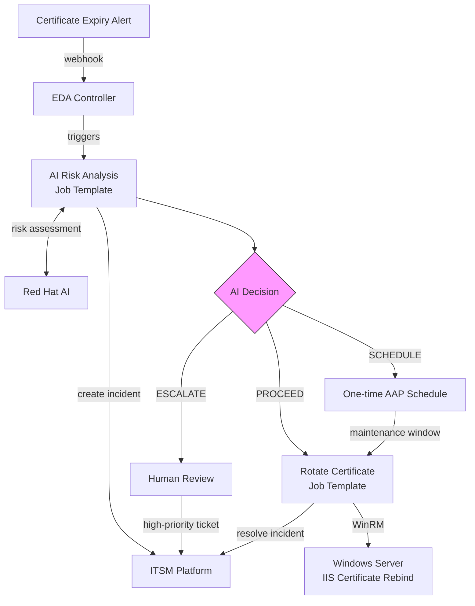

## Overview

Certificate rotation on Windows servers is manual, error-prone, and context-dependent. Finding the replacement cert, rebinding IIS, removing the old cert, verifying HTTPS, and updating the ticket is tedious enough. Doing it at the wrong time is worse: a load balancer health check flaps during rebind, marks the node as down, and a routine rotation becomes a P1 incident.

This guide automates both the execution and the judgment. Event-Driven Ansible detects expiring certificates via webhook. AI evaluates the risk (timing, dependencies, change freezes, compliance requirements) and determines whether to rotate now, schedule for the maintenance window, or escalate for human review. Ansible performs the rotation and documents everything in ITSM with a full audit trail.

### Business value

MTTR drops from hours of manual triage to under 2 minutes of automated response. Certificate-related outages from missed renewals are eliminated. Every rotation produces a documented audit trail (AI risk assessment, decision rationale, old/new thumbprints, HTTPS verification) that supports change management and encryption controls across common compliance frameworks.

### Technical value

Event-driven detection means action begins the moment a certificate is flagged. The rotation itself is fully automated, and AI adds a layer of review on top, evaluating service dependencies, change windows, and active incidents to ensure your applications stay up and the rotation is timed for the lowest possible risk.

---

## Background

Windows Server environments rely on IIS for hosting internal portals, APIs, and web applications. These servers use TLS certificates to encrypt traffic, and those certificates expire. Manually renewing and rebinding them to IIS is tedious, error-prone, and detrimental to your services when it doesn't happen on time.

Automating the rotation itself is straightforward: find the replacement cert, rebind IIS, remove the old cert, verify HTTPS. Ansible handles this reliably. However, blind automation can create its own risks. Rotating a certificate during peak trading hours on a financial portal, or while a dependent service is mid-deployment, or during a compliance audit freeze, can cause more disruption than the expiring cert itself. Letting the cert sit too long without acting means the certificate expires and causes the very outage you were trying to prevent.

The challenge is in the decision: should we rotate now, schedule it for the maintenance window, or flag it for human review? That decision depends on variables that change constantly, such as current time of day, service dependencies, change history, compliance requirements, concurrent incidents. This is where AI adds value. It evaluates the full risk picture for every expiry event and determines the optimal action, not a one-size-fits-all rule.

---

## Solution

### Components

-  **[Event-Driven Ansible](https://www.redhat.com/en/technologies/management/ansible/event-driven-ansible)** to detect certificate expiry events via webhook in real time
-  **[Red Hat AI](https://www.redhat.com/en/technologies/linux-platforms/enterprise-linux/ai)** (or any LLM inference endpoint) to assess risk and determine whether to proceed, schedule, or escalate
-  **[Ansible Automation Platform](https://www.redhat.com/en/technologies/management/ansible)** to rotate certificates and orchestrate the workflow via automation controller
-  **ITSM platform** (this example uses [ServiceNow ITSM](https://console.redhat.com/ansible/automation-hub/repo/published/servicenow/itsm/)) to track every rotation with a full audit trail from detection through resolution

### Who Benefits

| Persona | Challenge | What They Gain |
|---------|-----------|---------------|
|  **Windows Admin** | Certificate rotation is manual, repetitive, and easy to get wrong. Find the right replacement cert, rebind IIS, remove the old cert, verify HTTPS, update the ticket. Rotating too late causes an outage. Rotating at the wrong time, during peak load, an active deployment, or a change freeze, risks creating one. | Ansible automates rotation mechanics to ensure consistency and reliability, while AI evaluates timing, dependencies, and risk to determine the safest moment to rotate. |
|  **Security / Compliance** | Manual rotations produce inconsistent documentation, if any. Compliance audits require evidence that certificate changes were risk-assessed before execution, but manual processes rarely produce a meaningful audit trail. | Every rotation follows the same verified process and is documented in ITSM with AI risk assessment, decision rationale, old/new cert thumbprints, and HTTPS verification. Compliance evidence is generated automatically. |
|  **IT Manager** | Certificate outages are preventable but keep happening. Rotations depend on individual knowledge and availability, with no visibility into what was done, when, or why. | Consistent, automated rotation eliminates single points of failure. Measurable MTTR reduction, proactive rotation with intelligent scheduling, human-in-the-loop escalation for edge cases. Dashboard-ready metrics from ITSM. |

### Demos

- Interactive walkthrough: [Try the interactive Arcade demo](https://app.arcade.software/flows/1v4CnAXAopRJhJ4AUBF1/view)

<div style="text-align: left;"><iframe width="400" height="250" src="https://demo.arcade.software/1v4CnAXAopRJhJ4AUBF1?embed" frameborder="0" loading="lazy" allowfullscreen></iframe></div>

- Demo video: [Watch the demo](https://youtu.be/pX_PzMyYUk4)

<iframe src="https://www.youtube.com/embed/pX_PzMyYUk4" style="width: 100%; max-width: 400px; aspect-ratio: 16/9; display: block;" frameborder="0" allowfullscreen></iframe>

---

## Prerequisites

### Certificate Monitoring

Certificate monitoring that can send webhook alerts when certificates are approaching expiry (e.g., scheduled PowerShell scripts, SCOM, or a third-party monitoring tool). This is the event source that triggers the entire workflow. Configure alerts at multiple intervals (e.g., 90, 30, and 7 days before expiry) so the AI has time-to-expiry context when evaluating risk.

> **Tip:** In this guide we simulate certificate expiry events with a `curl` request to the EDA event stream.
>
> In production, use a purpose-built observability platform with native certificate monitoring capabilities -- such as <a target="_blank" href="https://www.dynatrace.com/">Dynatrace</a> or <a target="_blank" href="https://www.ibm.com/products/instana">IBM Instana</a> -- to automatically detect expiring certificates and fire webhook alerts to EDA without custom scripts or scheduled tasks.

### Red Hat Ansible Automation Platform

**Ansible Automation Platform 2.5+** with Event-Driven Ansible controller (GA).

> **New to Ansible?**
>
> Start here: <a target="_blank" href="https://developers.redhat.com/learn/ansible/foundations-ansible">Foundations of Ansible</a>, <a target="_blank" href="https://developers.redhat.com/learn/ansible/get-started-ansible-playbooks">Get started with Ansible Playbooks</a>

### Featured Ansible Content Collections

| Collection | Type | Purpose |
|-----------|------|---------|
| <a target="_blank" href="https://console.redhat.com/ansible/automation-hub/repo/published/ansible/windows/">ansible.windows</a> | Certified | Certificate management (`win_certificate_info`, `win_certificate_store`), IIS configuration, WinRM connectivity |
| <a target="_blank" href="https://console.redhat.com/ansible/automation-hub/repo/published/ansible/eda/">ansible.eda</a> | Certified | EDA webhook event source for certificate expiry events |
| <a target="_blank" href="https://console.redhat.com/ansible/automation-hub/repo/published/servicenow/itsm/">servicenow.itsm</a> | Certified | Create, update, and resolve ServiceNow incidents with full field control |
| <a target="_blank" href="https://console.redhat.com/ansible/automation-hub/repo/published/community/windows/">community.windows</a> | Community | `win_scheduled_task` for certificate monitoring scheduled task |

### External Systems

| System | Required | Notes |
|--------|----------|-------|
| Certificate monitoring | Yes | Any tool that can send webhook alerts on certificate expiry (e.g., scheduled PowerShell scripts, SCOM, third-party monitoring) |
| Windows Server 2019+ with IIS | Yes | Target for certificate rotation. WinRM must be configured (HTTP or HTTPS) |
| AI inference endpoint | Yes | Red Hat AI, or any LLM inference endpoint that returns structured JSON. The playbook uses a standard HTTP call, so it works with any provider |
| ITSM platform | Recommended | Incident tracking and audit trail. This example uses ServiceNow |

### Cost and Resource Notes

- AI API costs: one inference call per certificate expiry event (typically under $0.01/call)
- Event-Driven Ansible controller: included in AAP subscription, sized per standard <a target="_blank" href="https://docs.redhat.com/en/documentation/red_hat_ansible_automation_platform/2.5/html/planning_your_installation/">AAP planning guidance</a>

### Operational Impact per Stage

| Stage | Impact | Why |
|-------|--------|-----|
| **EDA rulebook activation** (Step 1) | None | Listens for webhook events, no system changes |
| **AI risk analysis** (Step 2) | Low | Creates an ITSM incident and triggers downstream jobs, but no direct infrastructure changes |
| **Certificate rotation** (Step 3a) | Medium | Rebinds IIS HTTPS binding; causes brief HTTPS interruption (< 60s) |
| **Maintenance window scheduling** (Step 3b) | None | Creates a one-time schedule in AAP, no immediate system changes |
| **ITSM resolution** (Step 4) | None | Updates incident record via API |

---

## Certificate Rotation Workflow

### System Architecture



### Narrative Walkthrough

The workflow starts when your existing certificate monitoring detects a certificate expiring within the configured threshold and sends a webhook event to the EDA event stream with the certificate thumbprint, host, and days remaining.

EDA matches the event against a rulebook condition and triggers the "AI Certificate Risk Analysis" job template. This playbook runs on localhost, calls an AI inference endpoint with certificate details and service context (CMDB data, dependencies, compliance requirements, change history), and produces a PROCEED, SCHEDULE, or ESCALATE decision.

- **PROCEED** -- The playbook launches the "Rotate Windows Certificate" job template immediately via the controller API.
- **SCHEDULE** -- The playbook creates a one-time schedule on the same job template for the next maintenance window, so the rotation is guaranteed to happen at the optimal time rather than left unresolved.
- **ESCALATE** -- The playbook updates the ITSM ticket to high priority and stops. Escalation is the right path when the risk picture is too complex for automated action: a wildcard cert affecting dozens of services, a compliance audit freeze, conflicting dependencies, or a host with a history of failed rotations.

If the AI service is unavailable, the playbook's rescue block automatically escalates for human review via a high-priority ITSM ticket, and the rotation job template remains available for the on-call team to launch manually.

The rotation playbook connects to the Windows host via WinRM, finds a valid replacement certificate, rebinds IIS, removes the old cert, verifies HTTPS, and resolves the ITSM incident with the full rotation details.

---

## Solution Walkthrough

### Step 1: Set up the EDA rulebook

**Operational Impact:** None

Your existing certificate monitoring sends webhook events to the EDA event stream when a certificate is expiring. The event payload should include:

| Field | Description | Example |
|-------|-------------|---------|
| `event_type` | Event classification | `cert_expiring` |
| `host` | Windows host private IP (for AAP inventory) | `<WINDOWS_HOST_IP>` |
| `thumbprint` | Certificate thumbprint to rotate | `<CERT_THUMBPRINT>` |
| `days_left` | Days until expiry | `5` |
| `subject` | Certificate subject name | `CN=<YOUR_CERT_DNS_NAME>` |

The rulebook listens for these events and triggers the AI risk analysis job template. The `days_left <= 7` condition acts as a final gate, but your monitoring system's alert schedule determines when events arrive. Adjust this threshold to match your environment.

> **Tip:** Consider configuring multiple EDA rules at different thresholds to take different actions as expiry approaches.
>
>For example, create an informational ITSM ticket at 30 days, trigger AI risk analysis at 7 days, and force immediate rotation at 1 day. Align these thresholds with the intervals your monitoring system is already alerting on.

```yaml
---
- name: Windows Certificate Expiry Watcher
  hosts: all
  sources:
    - ansible.eda.webhook:
        host: 0.0.0.0
        port: 5000

  rules:
    - name: Certificate expiring - trigger AI risk analysis
      condition: event.payload.event_type == "cert_expiring" and event.payload.days_left <= 7
      action:
        run_job_template:
          name: "AI Certificate Risk Analysis"
          organization: "Default"
          job_args:
            extra_vars:
              target_host: "{{ event.payload.host }}"
              cert_thumbprint: "{{ event.payload.thumbprint }}"
              days_left: "{{ event.payload.days_left }}"
```

**Rulebook activation configuration in EDA controller:**

| Field | Value |
|-------|-------|
| **Name** | `Windows Cert Expiry Watcher` |
| **Project** | `Windows Cert Rotation` (Git repo) |
| **Rulebook** | `cert_expiry_watcher.yml` |
| **Decision environment** | Default (or custom with `ansible.eda`) |
| **Credential** | AAP credential (for `run_job_template`) |
| **Restart policy** | `Always` (ensures the activation restarts automatically if the EDA controller restarts or the process crashes) |


### Step 2: AI risk analysis and decision routing

**Operational Impact:** None (API calls only)

The risk analysis playbook runs on localhost. It combines the certificate details with service context from your CMDB and asks the AI to make a decision.

The AI doesn't just look at how many days are left. It considers:

- **Current timing**: Is it during peak business hours? Is the maintenance window coming up?
- **Dependencies**: Will the F5 load balancer health check flap? Will SSRS embedded reports break?
- **Change history**: Has this host had failed rotations before?
- **Compliance**: Are there regulatory requirements for encryption continuity?
- **Operational context**: Is there a change freeze or concurrent incident?

**Featured task: AI inference call**

The playbook builds a prompt with certificate details, CMDB service context (dependencies, compliance requirements, change history), and decision criteria, then sends it to the AI:

```yaml
- name: Call AI for risk assessment
  ansible.builtin.uri:
    url: "http://{{ rhelai_server }}:{{ rhelai_port }}/v1/chat/completions"
    method: POST
    headers:
      Content-Type: "application/json"
      Authorization: "Bearer {{ rhelai_token }}"
    body_format: json
    body:
      model: "{{ rhelai_model | default('granite-3-8b-instruct') }}"
      max_tokens: "{{ llm_max_tokens | default(2048) }}"
      temperature: 0
      messages:
        - role: user
          content: "{{ assessment_prompt }}"
    return_content: true
    status_code: 200
    timeout: 30
  register: ai_assessment_response

- name: Parse AI decision
  ansible.builtin.set_fact:
    ai_decision: "{{ ai_assessment_response.json.choices[0].message.content | from_json }}"
```

This example uses Red Hat AI with a Granite model served via vLLM, which exposes a standard `/v1/chat/completions` endpoint. The same playbook works with any LLM provider that supports this API format. Swap the URL and credentials to point at a different provider without changing the playbook logic.

The AI returns a structured JSON response:

| Field | Description |
|-------|-------------|
| `decision` | `proceed`, `schedule`, or `escalate` |
| `risk_level` | `CRITICAL`, `HIGH`, `MEDIUM`, or `LOW` |
| `rationale` | 2-3 sentence explanation of the decision |
| `impact_analysis` | Detailed analysis covering dependencies, compliance, timing, and history |
| `precautions` | List of specific precautions to take during rotation |
| `scheduled_time` | (SCHEDULE only) Recommended maintenance window datetime in `YYYYMMDDTHHMMSSZ` format |
| `escalation_contacts` | (ESCALATE only) Who should review and why |

After receiving the AI decision, the playbook creates an ITSM incident with the full risk assessment before acting on the decision:

```yaml
- name: Create ServiceNow incident
  servicenow.itsm.incident:
    instance:
      host: "https://{{ snow_instance }}"
      username: "{{ snow_username }}"
      password: "{{ snow_password }}"
    state: new
    short_description: >-
      [{{ ai_decision.decision | upper }}] Certificate expiring on {{ target_host }}
    description: |
      Event-Driven Ansible detected an expiring SSL/TLS certificate.

      AI DECISION: {{ ai_decision.decision | upper }}
      RISK LEVEL: {{ ai_decision.risk_level }}

      Certificate: CN={{ cert_dns_name }}
      Thumbprint: {{ cert_thumbprint }}
      Host: {{ target_host }}

      --- AI Risk Assessment ---
      {{ ai_decision.impact_analysis }}
    impact: "{{ 'high' if ai_decision.decision == 'escalate' else 'medium' }}"
    urgency: "{{ 'high' if ai_decision.decision == 'escalate' else 'medium' }}"
    other:
      category: "Software"
      subcategory: "Certificate Management"
  register: snow_incident
```

**Job template configuration in automation controller:**

| Field | Value |
|-------|-------|
| **Name** | `AI Certificate Risk Analysis` |
| **Inventory** | `Windows Demo Inventory` |
| **Project** | `Windows Cert Rotation` |
| **Playbook** | `playbooks/ai_risk_analysis.yml` |
| **Credentials** | Machine credential (Windows admin) |
| **Extra variables** | `cert_dns_name: <YOUR_CERT_DNS_NAME>` |
| **Prompt on launch** | Extra variables enabled (receives `target_host`, `cert_thumbprint`, `days_left` from EDA) |

> **Tip:** Store AI and ITSM credentials in automation controller.
>
> Use custom credential types to inject API tokens as environment variables at runtime. Never hardcode secrets in playbooks. See <a target="_blank" href="https://docs.redhat.com/en/documentation/red_hat_ansible_automation_platform/">Creating Custom Credential Types</a> in the AAP documentation.


### Step 3a: Rotate the certificate (PROCEED path)

**Operational Impact:** Medium (brief HTTPS interruption, under 60 seconds)

When the AI decides PROCEED, the risk analysis playbook launches the "Rotate Windows Certificate" job template via the controller API. This job runs against the Windows host and performs four operations:

```yaml
- name: Find replacement certificate
  ansible.windows.win_shell: |
    $certs = Get-ChildItem Cert:\LocalMachine\My | Where-Object {
        $_.Subject -like "*{{ cert_dns_name }}*" -and
        $_.Thumbprint -ne "{{ cert_thumbprint }}" -and
        $_.NotAfter -gt (Get-Date)
    } | Sort-Object NotAfter -Descending
    if ($certs) {
        Write-Output $certs[0].Thumbprint
    } else {
        throw "No replacement certificate found for {{ cert_dns_name }}"
    }
  register: replacement_cert_result

- name: Rebind IIS HTTPS to replacement certificate
  ansible.windows.win_shell: |
    Import-Module WebAdministration
    $binding = Get-WebBinding -Name "{{ iis_site_name }}" -Protocol https
    $binding.AddSslCertificate("{{ new_cert_thumbprint }}", "My")

- name: Remove expired certificate from store
  ansible.windows.win_certificate_store:
    thumbprint: "{{ cert_thumbprint }}"
    state: absent
    store_location: LocalMachine
    store_name: My

- name: Verify HTTPS is still working
  ansible.windows.win_uri:
    url: "https://{{ cert_dns_name }}"
  register: verify_result

- name: Assert HTTPS is healthy
  ansible.builtin.assert:
    that: verify_result.status_code == 200
    success_msg: "IIS is serving HTTPS with the new certificate!"
    fail_msg: "IIS HTTPS check failed after certificate rotation"
```

The playbook expects a valid replacement certificate to already exist in the Windows certificate store. How that certificate gets there depends on your environment: ADCS auto-enrollment, a Venafi policy, HashiCorp Vault, or a manual renewal process. The rotation playbook handles the lifecycle from that point forward: find the replacement, rebind IIS, remove the old cert, verify HTTPS, and document everything in ITSM.


**Job template configuration in automation controller:**

| Field | Value |
|-------|-------|
| **Name** | `Rotate Windows Certificate` |
| **Inventory** | `Windows Demo Inventory` |
| **Project** | `Windows Cert Rotation` |
| **Playbook** | `playbooks/rotate_certificate.yml` |
| **Credentials** | Machine credential (Windows admin) |
| **Extra variables** | `cert_dns_name: <YOUR_CERT_DNS_NAME>` |
| **Prompt on launch** | Extra variables enabled (receives `cert_thumbprint`, `target_host`, `snow_incident_sys_id` from risk analysis) |


### Step 3b: Schedule for maintenance window (SCHEDULE path)

**Operational Impact:** None (creates a schedule, no immediate system changes)

When the AI decides SCHEDULE, the risk analysis playbook creates a one-time schedule on the rotation job template using the AAP controller API. The rotation is guaranteed to run during the next maintenance window without human intervention.

The AI may choose SCHEDULE over PROCEED for several reasons: the current time falls within peak business hours and the cert has enough runway to wait, a change freeze is in effect (quarter-end close, compliance audit), a high-risk upstream dependency like an F5 or ARR reverse proxy would be impacted by a rebind during active traffic, or a dependent service is mid-deployment and needs to stabilize first.

```yaml
- name: Schedule rotation job for maintenance window
  ansible.builtin.uri:
    url: "https://{{ aap_hostname }}/api/controller/v2/job_templates/{{ rotation_jt_id }}/schedules/"
    method: POST
    user: "{{ aap_username }}"
    password: "{{ aap_password }}"
    force_basic_auth: yes
    validate_certs: false
    body_format: json
    body:
      name: "Scheduled cert rotation - {{ cert_thumbprint[:12] }}"
      rrule: "DTSTART:{{ ai_decision.scheduled_time }} RRULE:FREQ=MINUTELY;INTERVAL=1;COUNT=1"
      extra_data:
        cert_thumbprint: "{{ cert_thumbprint }}"
        target_host: "{{ target_host }}"
        snow_incident_sys_id: "{{ snow_incident_sys_id }}"
        snow_incident_number: "{{ snow_incident_number }}"
  register: schedule_result
```


The playbook also updates the ITSM incident with the schedule details so the ticket shows when the rotation will happen and why it was scheduled for later.


### Step 4: Resolve in ITSM

**Operational Impact:** None (API call)

After the rotation playbook completes successfully, it resolves the ITSM incident with a factual record of what changed:

```yaml
- name: Resolve ServiceNow incident
  servicenow.itsm.incident:
    instance:
      host: "https://{{ snow_instance }}"
      username: "{{ snow_username }}"
      password: "{{ snow_password }}"
    sys_id: "{{ snow_incident_sys_id }}"
    state: resolved
    close_code: "Solved (Permanently)"
    close_notes: |
      Certificate rotation completed successfully by Event-Driven Ansible.

      Host: {{ inventory_hostname }}
      Service: IIS ({{ iis_site_name }}) HTTPS on port {{ iis_https_port }}
      Old certificate: {{ cert_thumbprint }} (removed)
      New certificate: {{ new_cert_thumbprint }} (now active)
      HTTPS verification: PASSED (status {{ verify_result.status_code }})
  delegate_to: localhost
  when: snow_incident_sys_id | default('') | length > 0
```

The ITSM incident now has the full story: the AI risk assessment from Step 2 (as the initial description and work notes), and the rotation results from Step 3a (as the close notes). This provides a complete audit trail from detection through resolution.


---

## Validation

### Per-Stage Checklist

| Stage | What to Verify | Success Indicator |
|-------|---------------|-------------------|
| EDA activation | Rulebook activation is running | EDA controller shows activation as **Running** |
| Webhook delivery | Event reaches EDA | Rulebook activation log shows received event JSON |
| Condition match | Correct rule fires | Activation log shows "Certificate expiring" rule matched |
| AI risk analysis | AI returns structured decision | Job output shows `DECISION: PROCEED/SCHEDULE/ESCALATE` with rationale |
| ITSM incident | Incident created with risk assessment | ITSM platform shows new incident with AI analysis in description |
| Rotation (PROCEED) | Certificate rotated and IIS rebound | Job output shows "IIS is serving HTTPS with the new certificate!" |
| Schedule (SCHEDULE) | One-time schedule created | AAP Schedules page shows "Scheduled cert rotation" entry |
| ITSM resolution | Incident resolved with rotation details | ITSM incident shows close notes with old/new thumbprints |
| Graceful fallback | AI unavailable, escalates for human review | High-priority ITSM incident created, noting AI service unavailable |

### Test: PROCEED Path

Send a test certificate expiry event to the EDA event stream:

```bash
curl -X POST "${EDA_EVENT_STREAM_URL}" \
  -H "Content-Type: application/json" \
  -H "Authorization: Bearer ${EDA_TOKEN}" \
  -d '{
    "event_type": "cert_expiring",
    "host": "<WINDOWS_HOST_IP>",
    "thumbprint": "<EXPIRING_CERT_THUMBPRINT>",
    "days_left": 3,
    "subject": "CN=<YOUR_CERT_DNS_NAME>"
  }'
```

Expected output (AI Risk Analysis job):

```ansible-output
TASK [Display AI decision] *****************************************************
ok: [localhost] => {
    "msg": [
        "DECISION: PROCEED",
        "RISK LEVEL: HIGH",
        "RATIONALE: With only 3 days until expiry and conditions clear for rotation,
         immediate action is necessary. Waiting for the next maintenance window would
         leave insufficient buffer time."
    ]
}

TASK [Display ServiceNow incident] *********************************************
ok: [localhost] => {
    "msg": "ServiceNow incident created: INC<NUMBER> (PROCEED)"
}

TASK [Display launched job] ****************************************************
ok: [localhost] => {
    "msg": [
        "Rotation job launched successfully.",
        "AAP Job ID: <JOB_ID>",
        "Job URL: https://<AAP_HOST>/#/jobs/<JOB_ID>/output"
    ]
}
```

Expected output (Rotate Windows Certificate job):

```ansible-output
TASK [Confirm replacement certificate found] ***********************************
ok: [<WINDOWS_HOST_IP>] => {
    "msg": "Found replacement certificate: <NEW_THUMBPRINT>"
}

TASK [Assert HTTPS is healthy] *************************************************
ok: [<WINDOWS_HOST_IP>] => {
    "msg": "IIS is serving HTTPS with the new certificate!"
}

TASK [Rotation complete] *******************************************************
ok: [<WINDOWS_HOST_IP>] => {
    "msg": "Certificate rotation complete. Old: <OLD_THUMBPRINT>
     -> New: <NEW_THUMBPRINT>. HTTPS verified. ServiceNow: INC<NUMBER>"
}
```

### Test: SCHEDULE Path

To test the SCHEDULE path, pass `additional_context` indicating peak business hours with enough runway for the cert to wait:

```bash
curl -X POST "${EDA_EVENT_STREAM_URL}" \
  -H "Content-Type: application/json" \
  -H "Authorization: Bearer ${EDA_TOKEN}" \
  -d '{
    "event_type": "cert_expiring",
    "host": "<WINDOWS_HOST_IP>",
    "thumbprint": "<EXPIRING_CERT_THUMBPRINT>",
    "days_left": 5,
    "subject": "CN=<YOUR_CERT_DNS_NAME>",
    "additional_context": "Currently peak business hours with high active user load. Maintenance window available in 2 days."
  }'
```

Expected output:

```ansible-output
TASK [Display AI decision] *****************************************************
ok: [localhost] => {
    "msg": [
        "DECISION: SCHEDULE",
        "RISK LEVEL: MEDIUM",
        "RATIONALE: Certificate has 5 days until expiry and a maintenance window is
         available within 2 days, providing a safe margin. Current peak load makes
         immediate rotation too risky."
    ]
}

TASK [Display scheduled rotation] **********************************************
ok: [localhost] => {
    "msg": [
        "Rotation scheduled in AAP for: <MAINTENANCE_WINDOW_DATETIME>",
        "Schedule name: Scheduled cert rotation - <THUMBPRINT_PREFIX>",
        "The rotation job will execute automatically during the maintenance window."
    ]
}
```

### Test: ESCALATE Path

To test the ESCALATE path, pass `additional_context` with a hard conflict the AI cannot resolve -- the certificate expires before the freeze lifts:

```bash
curl -X POST "${EDA_EVENT_STREAM_URL}" \
  -H "Content-Type: application/json" \
  -H "Authorization: Bearer ${EDA_TOKEN}" \
  -d '{
    "event_type": "cert_expiring",
    "host": "<WINDOWS_HOST_IP>",
    "thumbprint": "<EXPIRING_CERT_THUMBPRINT>",
    "days_left": 3,
    "subject": "CN=<YOUR_CERT_DNS_NAME>",
    "additional_context": "Mandatory compliance audit freeze in effect for 14 days. No production changes permitted under any circumstances. Certificate expires before the freeze lifts."
  }'
```

Expected output:

```ansible-output
TASK [Display AI decision] *****************************************************
ok: [localhost] => {
    "msg": [
        "DECISION: ESCALATE",
        "RISK LEVEL: HIGH",
        "RATIONALE: Certificate expires in 3 days but the compliance audit freeze
         prohibits any production changes for 14 days. The certificate will expire
         before automation can safely act. Human review is required."
    ]
}

TASK [Display workflow summary] ************************************************
ok: [localhost] => {
    "msg": "Risk analysis complete. Decision: ESCALATE. ServiceNow: INC<NUMBER>"
}
```


> **Note:** The AI generates unique rationale text on each run.
>
> The decision structure and fields remain consistent, but the wording will vary. The same `additional_context` may produce different decisions depending on timing and how the AI weighs the constraints.

### Troubleshooting

| Symptom | Likely Cause | Fix |
|---------|-------------|-----|
| `ntlm: auth method ntlm requires a password` | Machine credential not associated with job template | Associate the credential with the job template via AAP UI or API |
| WinRM connection timeout | Wrong port/scheme in inventory (5986/HTTPS vs 5985/HTTP) | Match the port and scheme to what's configured on the Windows host. Check with `winrm enumerate winrm/config/listener` |
| `No replacement certificate found` | No valid cert with matching subject in the store | Run a cert provisioning playbook first, or verify ADCS auto-enrollment. Check: `Get-ChildItem Cert:\LocalMachine\My` |
| Schedule creation returns 400 | DTSTART format wrong | AAP requires compact `YYYYMMDDTHHMMSSZ` format, not ISO 8601 with dashes and colons |
| AI service returns 401/403 | Token expired or invalid API key | Regenerate the access token or verify the API key is active in your AI platform's console |

---

## Maturity Path

| Maturity | Description | What to Build |
|----------|-------------|---------------|
|  **Crawl** | EDA detects expiring certs and triggers AI risk analysis. ITSM ticket is created with AI enrichment (risk level, rationale, recommended action). Operators review the AI recommendation and manually launch or schedule the rotation job. | AI risk analysis job template. ITSM integration for ticket creation. Rotation job template available for manual launch. |
|  **Walk** | AI risk analysis evaluates every expiry event and acts on the decision automatically. PROCEED rotates immediately. SCHEDULE creates a one-time AAP schedule for the maintenance window. ESCALATE flags edge cases for human review. Full audit trail in ITSM from detection through resolution. | Two job templates (risk analysis + rotation). ITSM integration for incident lifecycle. `additional_context` variable for operational overrides. Graceful fallback escalation when AI is unavailable. |
|  **Run** | Extend the workflow with automated certificate generation from your CA (ADCS, Venafi, HashiCorp Vault), pre/post-rotation application health checks, traffic draining from load balancers before rotation, and CMDB-driven service dependency mapping. | CA request playbook using `community.crypto` or your CA's API. Health check playbooks that verify application functionality before and after rotation. Load balancer integration to drain connections before rebinding. Workflow job templates that chain the full lifecycle. |

---

## ROI Recap

By connecting certificate monitoring to Event-Driven Ansible with AI-informed decision making, you have turned a reactive, manual process into a governed, event-driven pipeline:

- **MTTR reduction**: Automated response drops mean time to resolution from hours (manual triage, rotation, verification) to under 2 minutes (detect, assess, rotate, verify)
- **Zero-touch routine rotations**: Certificates that the AI evaluates as safe to rotate are handled without human involvement, including ITSM documentation
- **Intelligent scheduling**: When conditions are not ideal (peak hours, change freezes, high-risk dependencies), the AI schedules rotation for the next maintenance window rather than taking unnecessary risk. The rotation is guaranteed to happen at the optimal time, not left unresolved
- **Compliance evidence**: Every rotation is documented in ITSM with the AI risk assessment, old and new certificate thumbprints, and HTTPS verification status. This supports change management and encryption controls across common compliance frameworks.
- **Graceful fallback**: If the AI service is unavailable, the workflow escalates for human review via a high-priority ITSM ticket. The rotation job template remains available for manual launch, preserving human oversight when automated risk assessment is not possible
- **Manual override**: The rotation playbook can be launched manually for planned rotations, testing, or one-off hosts, bypassing the AI gate entirely. One playbook, two entry points.

### Measuring Success

Start capturing these metrics before enabling automated rotation so you have a baseline to measure improvement against.

| Metric | What to Capture | Where to Find It |
|--------|----------------|-----------------|
| **Mean time to resolution (MTTR)** | Time from cert expiry alert to rotation complete, before and after automation | ITSM incident open-to-resolved duration |
| **Certificate-related outages** | Count of outages caused by expired or misconfigured certs | ITSM incident count filtered by category "Certificate Management" |
| **Rotation success rate** | Percentage of automated rotations that complete without human intervention | AAP job status (successful vs. failed) |
| **AI decision distribution** | Breakdown of PROCEED / SCHEDULE / ESCALATE decisions | AAP job output; ITSM incident short descriptions (prefixed with decision) |
| **Scheduled rotation adherence** | Percentage of SCHEDULE decisions that execute successfully during the maintenance window | AAP schedule execution history |
| **Fallback activations** | Count of escalations triggered by AI service unavailability (rescue block) | AAP job output showing AI unavailable escalation |

---

## Related Guides

-  **AIOps reference architecture:** [AIOps automation with Ansible](README-AIOps.md) covers the foundational patterns for AI-driven automation that this guide builds on
-  **ServiceNow integration:** [ServiceNow ITSM Ticket Enrichment](README-ServiceNow-ITSM.md) for deeper ITSM automation patterns, including AI-enriched ticket updates
-  **AI infrastructure:** [AI Infrastructure automation with Ansible](README-IA.md) for deploying your own AI inference endpoint instead of using a cloud API

---

## Sources

### Red Hat Ansible Automation Platform

| Resource | What you get |
|----------|-------------|
| <a target="_blank" href="https://www.redhat.com/en/technologies/management/ansible">Ansible Automation Platform</a> | Product overview, trial, and pricing |
| <a target="_blank" href="https://www.redhat.com/en/technologies/management/ansible/event-driven-ansible">Event-Driven Ansible</a> | Product overview for the real-time event processing layer |
| <a target="_blank" href="https://console.redhat.com/ansible/automation-hub/repo/published/ansible/windows/">ansible.windows on Automation Hub</a> | Collection details for Windows certificate and IIS management |
| <a target="_blank" href="https://console.redhat.com/ansible/automation-hub/repo/published/ansible/eda/">ansible.eda on Automation Hub</a> | Collection details for EDA webhook sources and event filters |
| <a target="_blank" href="https://console.redhat.com/ansible/automation-hub/repo/published/servicenow/itsm/">servicenow.itsm on Automation Hub</a> | Collection details for ServiceNow ITSM incident management |

---

## Next Steps

| | |
|---|---|
| <a target="_blank" href="https://www.redhat.com/en/technologies/management/ansible/trial"><strong>Try Ansible Automation Platform</strong></a> | Start a free 60-day trial and build your first automation workflows |
| <a target="_blank" href="https://www.redhat.com/en/services/consulting"><strong>Red Hat Consulting</strong></a> | Work with Red Hat experts to design and scale certificate lifecycle automation |
| <a target="_blank" href="https://www.redhat.com/en/services/training-and-certification"><strong>Training and Certification</strong></a> | Build team skills with hands-on courses and certifications |

---

<span class="guide-closing-logo-set">


</span>

