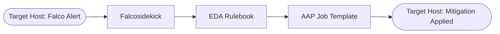

## Overview

Organizations managing Linux Operational Technology (OT) hosts struggle to respond to runtime threats quickly enough to prevent system compromise. This guide demonstrates how to build a closed-loop automated enforcement architecture using Falco for runtime syscall monitoring and Event-Driven Ansible (EDA) for orchestration to dynamically apply MITRE ATT&CK mitigation policies.

## Background

In OT environments, response time to security events is critical. Traditional security monitoring often relies on human intervention to review alerts and apply mitigations, which can take hours or days. Automated runtime mitigation reduces this window to seconds by connecting threat detection directly to remediation workflows.

This solution leverages the MITRE ATT&CK for ICS framework to map specific runtime behaviors (like spawning unauthorized shells) to predefined Ansible mitigation playbooks, ensuring that responses are both immediate and appropriate for the detected threat.

## Solution

- **Falco** for runtime syscall monitoring and threat detection
- **Falcosidekick** for routing alerts to external systems
- **Event-Driven Ansible (EDA)** to listen to real-time security events and trigger responses
- **Ansible Automation Platform (AAP)** workflows for orchestration and applying mitigation policies

### Who Benefits

| Persona | Challenge | What They Gain |
|---------|-----------|---------------|
| Security Operations (SecOps) | Cannot manually respond to runtime threats fast enough to prevent compromise | Automated, sub-minute mitigation of detected MITRE ATT&CK techniques |
| OT Infrastructure Engineer | Needs to ensure security responses do not disrupt critical OT services | Governed, predictable mitigation policies mapped to specific threat IDs |
| IT/Security Director | Struggles to prove compliance and rapid response capabilities | A closed-loop enforcement architecture with visual reporting |

**Operational Impact:** Medium

## Prerequisites

### Ansible Automation Platform

- **Ansible Automation Platform 2.5+** -- Required for Event-Driven Ansible (EDA) controller integration.

### Featured Ansible Content Collections

| Collection | Type | Purpose |
|-----------|------|---------|
| [ansible.eda](https://console.redhat.com/ansible/automation-hub/repo/published/ansible/eda/) | Certified | EDA event sources and webhook filters |

### External Systems

| System | Required | Examples |
|--------|----------|----------|
| Target Hosts | Yes | RHEL 9 OT targets with internet or repository access to install Falco RPMs |
| Reporting Host | Yes | A host to compile and serve the HTML dashboard |

## Mitigation Workflow



1. **Trigger:** Falco continuously evaluates syscalls on the OT hosts. When it identifies behavior matching its rules, it logs an alert mapped to an ATT&CK ICS technique ID.
2. **Forwarding:** Falcosidekick forwards this alert payload to the EDA Controller via HTTP POST.
3. **Enforcement:** The EDA rulebook interprets the severity. If it is a "Critical" or "Error" severity, it triggers the `FALCO_MITRE -- Enforce` Job Template.
4. **Execution:** The dispatcher playbook evaluates the technique ID against a mapping file and executes the designated mitigation roles on the compromised host.

## Solution Walkthrough

**Source Code:** The complete playbooks, rulebooks, and roles for this guide are available in the [FALCO_MITRE repository](https://github.com/redhat-cop/FALCO_MITRE).

### Configuration Variables

Before deploying, ensure these variables are defined in your inventory or `group_vars/all.yml`:

- **`falcosidekick_eda_url`**: The exact webhook endpoint on your EDA Controller.
- **`falcosidekick_eda_token`**: The authentication token for the stream.
- **`m0938_fapolicyd_trusted_paths`**: (List) Any unique, vendor-provided binaries on the OT hosts that `fapolicyd` must whitelist.
- **`m0942_services_to_disable`**: (List) Services that get forcefully masked on compromised hosts.
- **`report_web_root`**: Path to host the HTML dashboard (Default: `/var/www/falco_mitre`).

### Step 1: Configure AAP Controller

**Operational Impact:** Low

Create the Job Template that EDA will trigger when a threat is detected. Ensure the name matches exactly what is configured in the EDA rulebook.

| Field | Value |
|-------|-------|
| **Name** | `FALCO_MITRE -- Enforce` |
| **Project** | Your FALCO_MITRE Git project |
| **Playbook** | `playbooks/dispatcher.yml` |
| **Inventory** | Your configured inventory (`ot_hosts` and `report_host`) |
| **Credentials** | Machine Credential |
| **Variables / Options** | Check **Prompt on Launch** for Variables |

> **Warning:** Prompt on Launch is critical.
>
> EDA will inject `technique_ids` and `source_host` directly into the extra variables at runtime. If this is not checked, the playbook will fail to target the correct host or apply the correct mitigation.

### Step 2: Configure EDA Controller

**Operational Impact:** Low

Create the webhook receiver and rulebook activation to process Falco alerts.

1. **Create the Event Stream:** In the EDA controller, create an Event Stream for external webhooks. Copy the URL and generate a Token.
2. **Create the Rulebook Activation:**
   - **Name:** `FALCO_MITRE Loop`
   - **Rulebook:** `falco_enforcement.yml`
   - **Controller Token:** Provide the AAP Controller API token credential.
   - **Restart Policy:** Always.

### Featured Code: EDA Rulebook

The rulebook listens for POST payloads from Falcosidekick and triggers the mitigation job template when a critical or error-level event occurs.

```yaml
---
- name: Listen for Falco events
  hosts: all
  sources:
    - ansible.eda.webhook:
        host: 0.0.0.0
        port: 5000

  rules:
    - name: Trigger mitigation on Critical or Error severity
      condition: event.payload.priority in ['Critical', 'Error']
      action:
        run_job_template:
          name: "FALCO_MITRE -- Enforce"
          organization: "Default"
          job_args:
            extra_vars:
              source_host: "{{ event.payload.hostname }}"
              technique_ids: "{{ event.payload.tags | select('match', '^T[0-9]+') | list }}"
```

### Featured Code: Mitigation Dispatcher

The dispatcher playbook receives the `technique_ids` and maps them to specific mitigation roles.

```yaml
---
- name: Enforce MITRE ATT&CK Mitigations
  hosts: "{{ source_host | default('all') }}"
  become: true
  tasks:
    - name: Load attack mapping
      ansible.builtin.include_vars:
        file: data/attack_map.yml
        name: attack_map

    - name: Dispatch mitigation roles based on technique IDs
      ansible.builtin.include_role:
        name: "{{ attack_map[item].role }}"
      loop: "{{ technique_ids }}"
      when: item in attack_map
```

### Step 3: Deploy Falco and Reporting Dashboard

**Operational Impact:** Medium

Deploy Falco to the target OT hosts and set up the HTML reporting engine. You must provide the EDA webhook URL and token so Falcosidekick can authenticate.

```bash
# 1. Deploy Falco and Falcosidekick
ansible-playbook -i inventory/hosts.yml playbooks/deploy_falco.yml \
  -e falcosidekick_eda_url="https://aap.example.com/eda-event-streams/api/eda/v1/external_event_stream/<UUID>/post/" \
  -e falcosidekick_eda_token="<your-token>" \
  -e '{"m0938_fapolicyd_trusted_paths": ["/opt/scada-system/bin"]}'

# 2. Deploy the Reporting Dashboard
ansible-playbook -i inventory/hosts.yml playbooks/deploy_report.yml
```

> **Tip:** Valid vs. Invalid Configurations.
>
> Ensure `falcosidekick_eda_token` is a real, secure token. Leaving it as a placeholder like `"CHANGEME"` will cause Falcosidekick to constantly throw `401 Unauthorized` errors in syslog when attempting to transmit alerts.

## Validation

### Test

Simulate an attack by SSHing into an OT host and intentionally running a command as an underprivileged user to spawn a shell. This will trip the `T1059` detection rule.

```bash
ssh root@rhel01.example.com "sudo -u nobody bash -c 'echo test'"
```

### Expected Result

Navigate to the AAP Controller UI and look at the Jobs list. You should see a new execution for `FALCO_MITRE -- Enforce`. The output for the dispatch log should show:

```yaml
TASK [Log dispatch event] ********************************************
ok: [rhel01.example.com] => {
    "msg": "DISPATCH: source=falcosidekick host=rhel01.example.com techniques=['T1059'] mode=full"
}
```

Verify on the target host that the mitigations applied successfully:

```bash
getenforce
fapolicyd-cli --list
```

Finally, check the HTML dashboard at `<a target="_blank" href="http://YOUR-REPORT-HOST:8088/">http://YOUR-REPORT-HOST:8088/</a>` to see the visual report of the mitigation event.

### Troubleshooting

| Symptom | Likely Cause | Fix |
|---------|-------------|-----|
| EDA Rulebook fails to trigger job | Missing Job Template name, or missing *Prompt on Launch* | Verify the Job Template is named exactly `FALCO_MITRE -- Enforce`. Check the EDA activation logs in the AAP UI. |
| Falco is triggering, but no webhook reaches EDA | Invalid URL/token, or no route to the EDA controller | Read logs on the OT host: `journalctl -u falcosidekick`. Look for `401 Unauthorized` or network timeout errors. |
| Dispatcher playbook finds no mitigations | Technique ID is missing from `attack_map.yml` | The job output will warn: `WARNING: technique <ID> not found in attack_map`. Run `python tools/generate_attack_map.py` to sync mapping files. |
| AAP Controller connection error in EDA | Missing Controller API Token | Open the rulebook activation in EDA, navigate to the `Controller Tokens` tab, and ensure a valid token is assigned. |

## Maturity Path

| Maturity | Description |
|----------|-------------|
| **Crawl** | Falco monitors syscalls and generates alerts for manual review. |
| **Walk** | EDA receives Falco alerts and creates ITSM tickets for security teams. |
| **Run** | EDA automatically triggers Ansible playbooks to apply runtime mitigations (e.g., masking services, enforcing fapolicyd) within seconds of detection. |

## Summary

This guide demonstrated how to integrate Falco, Falcosidekick, and Event-Driven Ansible to create a closed-loop enforcement architecture for Linux OT hosts. By mapping MITRE ATT&CK ICS techniques to specific Ansible mitigation playbooks, organizations can reduce their response time to runtime threats from hours to seconds, minimizing the risk of system compromise.

## Related Guides

- [AIOps automation with Ansible](README-AIOps.md)
